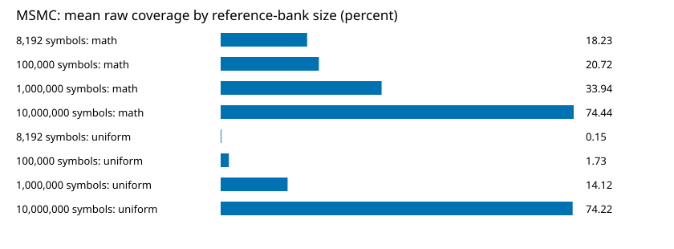
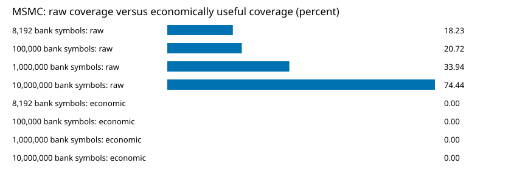
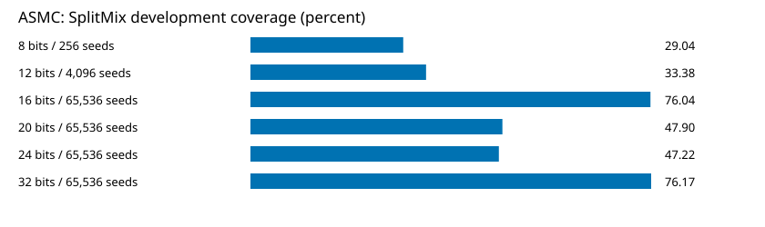
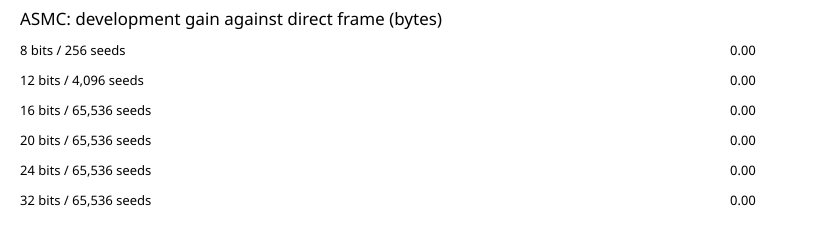
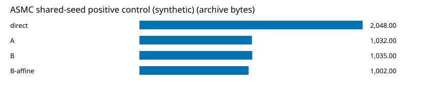

# SXZ — Searching for Data in the Universe of Mathematics

*An open research project exploring mathematical and generative approaches to lossless data compression.*

[English](README.md) | [Persian](README-fa.md)

## How It All Started

What if, instead of storing information bit by bit, we could describe it using mathematical rules, formulas, constants, and numerical sequences — and regenerate the original data whenever we needed it?

You may have heard that your phone number, your birthday, and potentially much longer sequences of information could be hiding somewhere within the digits of π. Although it has not been proven that every possible finite digit sequence occurs in π, I find the possibility itself fascinating.

Perhaps you've also generated a random number and noticed that several of its digits happen to match part of your own phone number.

Now imagine doing this on a much larger scale. Instead of a handful of digits, imagine millions or billions of symbols. Instead of a single mathematical constant, imagine an entire library of mathematical functions, number-theoretic sequences, prime numbers, constants, and pseudorandom generators.

Could we find pieces of our digital information somewhere within these sequences? Could we store instructions for regenerating those pieces rather than storing the pieces themselves? And, most importantly, could those descriptions actually be smaller than what existing compression algorithms produce?

These are the questions that led me to start SXZ.

## Why I Think This Is Worth Exploring

Even if we could achieve just a 2% reduction in compressed size compared with strong existing compression algorithms, that improvement could be valuable given the enormous amount of data humanity stores and transfers every day.

One particularly interesting possibility is asymmetric compression: performing computationally expensive searches during encoding while keeping decoding fast and lightweight.

If successful, such an approach could have applications in cloud storage, data transmission, data centers, software distribution, and AI model distribution.

We can use AI agents to formulate hypotheses, develop algorithms, run experiments, and analyze results. Combining these capabilities with careful controls, reproducible artifacts and substantial computational resources might open research directions that were previously harder to investigate.

Of course, more computing power alone does not guarantee a solution. Perhaps the answer lies in a better algorithm. Perhaps it requires an entirely different mathematical formulation of the problem.

That is part of what makes this research interesting.

## Has This Idea Been Explored Before?

Yes, aspects of this idea have been explored before. I personally discovered several of these earlier attempts after already going through multiple stages of developing SXZ.

Some interesting examples include:

- [GB2401443A](https://patents.google.com/patent/GB2401443A/en) — a patent application with a 2003 priority date, exploring data compression through the locations of digit sequences within irrational numbers.
- [CN113553002A](https://patents.google.com/patent/CN113553002A/en) — a 2021 patent application exploring compression and storage using properties of irrational numbers.
- [pi-encode](https://github.com/daxtens/pi-encode) — an experimental implementation exploring how information can be located within the binary digits of π.
- [Achieving Awful Compression with Digits of Pi](https://ntietz.com/blog/why-we-cant-compress-messages-with-pi/) — a 2024 experiment demonstrating the difficulties of compressing information through references to π.
- [PiC — Constants as Compression Generators](https://www.mdlxdcc.org/crp/pic) — a closely related research proposal exploring mathematical constants as generative sources for compression.

I see these earlier attempts as an opportunity to learn from others rather than a reason to abandon the question.

SXZ attempts to investigate a broader collection of hypotheses systematically, ranging from algebraic relationships and program synthesis to mathematical sequence mosaics, alternative numerical representations, and adaptive pseudorandom generators.

## An Invitation to Curious Minds

I started this project out of personal curiosity, with the limited computational resources available to me and the help of two AI systems: **GPT-6.2 (Sol)** as a research and discussion partner, and **DeepSeek V4.1 Flash** as a coding and experimentation agent.

With their assistance, I explored hypotheses, developed experimental architectures, implemented algorithms, and examined the results. Some experiments produced remarkable results on synthetic data. Others failed to provide meaningful improvements on real-world files. The AI systems assisted the research; their outputs are not a substitute for independent verification.

But I don't want this project to be limited to my own ideas or experiments.

I'm genuinely excited to see what a mathematician, computer scientist, machine learning researcher, compression expert, or simply another curious developer might discover by approaching the problem from a different perspective.

If you have access to substantial computational resources, enjoy number theory, work on compression algorithms, or simply love experimenting with unconventional ideas, I would love to see what you can bring to this project. Perhaps someone with powerful GPUs, better search strategies, or expertise in machine learning can take the exploration further than I could.

Even a rigorous mathematical argument demonstrating why one of our hypotheses cannot work would be a valuable scientific contribution.

I am looking forward to seeing where our collective curiosity takes us.

---

## What Is SXZ?

SXZ is an experimental research framework investigating mathematical and algorithmic descriptions of digital information for lossless data compression.

Its objective is to discover shorter descriptions from which the original information can be regenerated exactly, without losing a single bit.

SXZ is not a production-ready compression utility, nor is it a proven replacement for ZIP, Zstandard, Brotli, or LZMA. It is a collection of experimental engines, mathematical tools, algorithms, benchmarks, and research findings.

The central research question is:

**Can mathematical and generative representations describe digital information more economically than existing compression methods?**

## Explore the Repository

- [Research overview](research/overview.md) and [timeline](research/timeline.md)
- [Experimental phases](research/phases/README.md) and [mathematical foundations](research/mathematical-foundations.md)
- [Consolidated findings](research/findings.md), [errata](research/errata.md), and [related work](research/related-work.md)
- [Raw experimental results](results/README.md) and [reproduction instructions](docs/reproduction.md)
- [Open research questions](research/open-questions.md), [contributing](CONTRIBUTING.md), [authors](AUTHORS.md), [license](LICENSE), and [citation](CITATION.cff)

## Research Journey

The project has evolved through multiple experimental phases. Each phase investigates a different aspect of the original hypothesis.

| Phase | Research focus |
|---|---|
| 01 — SXZ1 | Original hypothesis and mathematical pattern encoding |
| 02 — SXZ2 | Streaming architecture and native optimization |
| 03 — Detection Audit | Search limitations, missed patterns, and detection accuracy |
| 04 — SXZ3 | Extended mathematical models and residual coding |
| 05 — SXZ4 | Mathematical spans and reversible representation discovery |
| 06 — Validation | Comprehensive real-world experiments and ablation studies |
| 07 — SXZ-NEXT | Hierarchical generative programs, algebraic inference, and native scanning |
| 08 — Structural Relations | Mathematical relationships between non-contiguous data structures |
| 09 — MSMC | Mathematical Sequence Mosaic Compression |
| 10 — ASMC | Adaptive Stochastic Mosaic Compression |
| 11 - CGMC | Context-conditioned generators, strict attribution and decoder audit |
| 12 - AMRD | Direct algebraic inference, reversible representations and cross-plane screens |
| 13 - Scaling | Nested real-data sizes and mathematical cost diagnostics |
| 14 - Number Theory | 2-adic rationals, coordinate functions and quadratic Boolean relations |
| 15 - Image Math | Pixel-coordinate functions, adaptive regions and compositional networks |

### Five More Phases, and What They Taught Me

After Phase 10 I followed five more lines of inquiry: context-conditioned generators (CGMC), direct algebraic discovery (AMRD), a scaling and cost study, 2-adic and algebraic number-theory experiments, and mathematical image representations. I kept the same rule throughout: compare against matched conventional baselines, count every byte of the description, and preserve the negative results.

The outcome did not overturn the earlier conclusion. CGMC's strict controls and decoder audit clarified what its apparent wins did and did not mean, but no real file passed the economic gate. AMRD recovered synthetic laws exactly and found no nontrivial real polynomial or affine span. The scaling study showed that larger files did not create proportional mathematical coverage; genuine affine hits remained rare and none beat zstd-9 on the same span. The number-theory phase found a small, exact 2-adic description in the padding region of `7zr.exe`, but its simpler form is a 16-bit arithmetic progression with carry, and it did not survive as an archive-level gain. The image phase produced only one isolated 9-byte improvement on a gull crop (about 0.0104%); complete images remained negative.

| Phase | What I tested | What I found |
|---|---|---|
| 11 - CGMC | Context-conditioned mathematical generators with strict attribution and a decoder audit | No real economic gate pass; strict controls and long-range checks explained the apparent wins |
| 12 - AMRD | Direct algebraic inference, reversible representations and cross-plane screens | Synthetic laws recovered exactly; no nontrivial real span at the tested scales |
| 13 - Scaling | Nested real-data sizes and the real cost of formulas, states, residuals and metadata | No proportional coverage scaling; genuine affine hits were rare and never beat zstd-9 on their span |
| 14 - Number Theory | 2-adic rationals, coordinate functions and quadratic Boolean relations | A limited 7zr span-level 2-adic/AP result; coordinate and GF(2) results negative; no archive gain |
| 15 - Image Math | Pixel-coordinate functions, adaptive regions and compositional networks | One isolated 9-byte gull-crop win (0.0104%); complete-image results negative |

I see these as useful boundary markers rather than failures to hide. They tell me where simple mathematical descriptions stop being competitive, and they make the remaining question sharper: which real sources have short, independently meaningful descriptions that conventional codecs cannot already capture? That is the question I want to keep exploring.

## Core Research Directions

SXZ explores several complementary approaches:

- Mathematical pattern detection
- Algebraic inference and recurrence discovery
- Symbolic regression and program synthesis
- Generative mathematical dictionaries
- Number-theoretic sequences
- Mathematical constants as information sources
- Reversible numerical representations
- Pseudorandom generator recovery
- Adaptive seed and parameter selection
- Shared generative descriptions
- Non-contiguous structural relationships
- Exact and approximate sequence matching
- Information-theoretic description costs
- Asymmetric compression architectures

## Selected Experimental Findings

| Experiment | Observed result |
|---|---|
| Synthetic second-order recurrence | 256 KiB represented in 84 bytes |
| Synthetic linear congruential generator | 256 KiB represented in 79 bytes |
| Fibonacci sequence reconstruction | 16,428-byte baseline reduced to 57 bytes |
| Prime-number sequence reconstruction | 10,009-byte baseline reduced to 48 bytes |
| Native mathematical scanning | 100 MB scanned in 0.68 seconds for one specific recurrence family |
| Mathematical sequence mosaic | 74.44% average raw pattern coverage on a five-file development panel |
| Target-fitted non-uniform generator bank | 48.12% average raw coverage on a 22-file real-world panel |
| Shared-seed synthetic mosaic | 2,048-byte baseline reduced to 1,002 bytes |

These results come from different experimental settings and should not be interpreted as a single comparative benchmark.

Several impressive compression ratios were obtained on deliberately constructed synthetic data. High pattern coverage on real-world data did not translate into equivalent compression savings.

### Selected figures

Figures are generated from the preserved JSON by [`scripts/evidence.py`](scripts/evidence.py); see the [figure index](figures/README.md). Raw coverage is not an archive-size saving.

The complete experimental reports document the methodology, controls, archive overhead, and limitations behind these figures.

## Current Research Status

After fifteen phases I can say something both encouraging and sobering: mathematical descriptions can be astonishingly effective when the data really comes from a recoverable law, but I have not yet found a repeatable, independent compression gain on general real-world files.

The last five phases made that boundary sharper. CGMC's strict controls, AMRD's empty real algebraic coverage, the scaling study's lack of a size advantage, the single span-level 2-adic/AP result in `7zr.exe`, and the image phase's isolated 9-byte gull-crop win all point the same way. They are real measurements, not reasons to stop asking, but they are not a product claim.

A particularly important finding is that locating information within a mathematical sequence is not sufficient. The cost of describing its location, generator, parameters, and residual information must also be considered.

SXZ does not claim to circumvent the fundamental limits of lossless compression described by information theory and algorithmic complexity.

The goal is to investigate whether better representations and search strategies can exploit compressible structure that existing methods may not fully capture.

## What You Will Find in This Repository

- Python and Rust source code
- Historical experimental compression engines
- Research reports organized by phase
- Mathematical foundations and theoretical analysis
- Experimental protocols
- Raw benchmark results
- Ablation studies
- Performance measurements
- Reproducible synthetic datasets
- Scientific figures and comparison tables
- Lossless reconstruction tests
- Open research questions

Both positive and negative findings are preserved. Failed experiments are part of the scientific record, not something to hide.

## Getting Started

See the research documentation for the complete experimental history, installation requirements, reproduction procedures, dataset descriptions, and benchmark methodology.

Researchers interested in a particular mathematical approach can start directly with the corresponding experimental phase.

## Contributing

Contributions are welcome from anyone interested in exploring this problem.

Possible contributions include:

- New mathematical hypotheses
- Alternative generative representations
- Number theory and algebraic approaches
- Machine learning and neural compression
- GPU-accelerated mathematical search
- Improved program synthesis
- Information-theoretic analysis
- Independent reproduction of existing results
- New benchmarks and experimental datasets
- Critical evaluation of existing hypotheses

Have an idea? Open an issue.

Have experimental results? Share them.

Have a better approach? Submit a pull request.

Disagreement, negative results, and mathematical counterarguments are just as welcome as successful implementations.

## The Bigger Picture

SXZ is not necessarily about making the current architecture work at all costs.

It is about exploring a question that I find genuinely fascinating: how much of the information we store can instead be described through mathematics, and how efficiently can we regenerate it?

Perhaps the most interesting solution has not been considered yet.

Let's explore it together.
